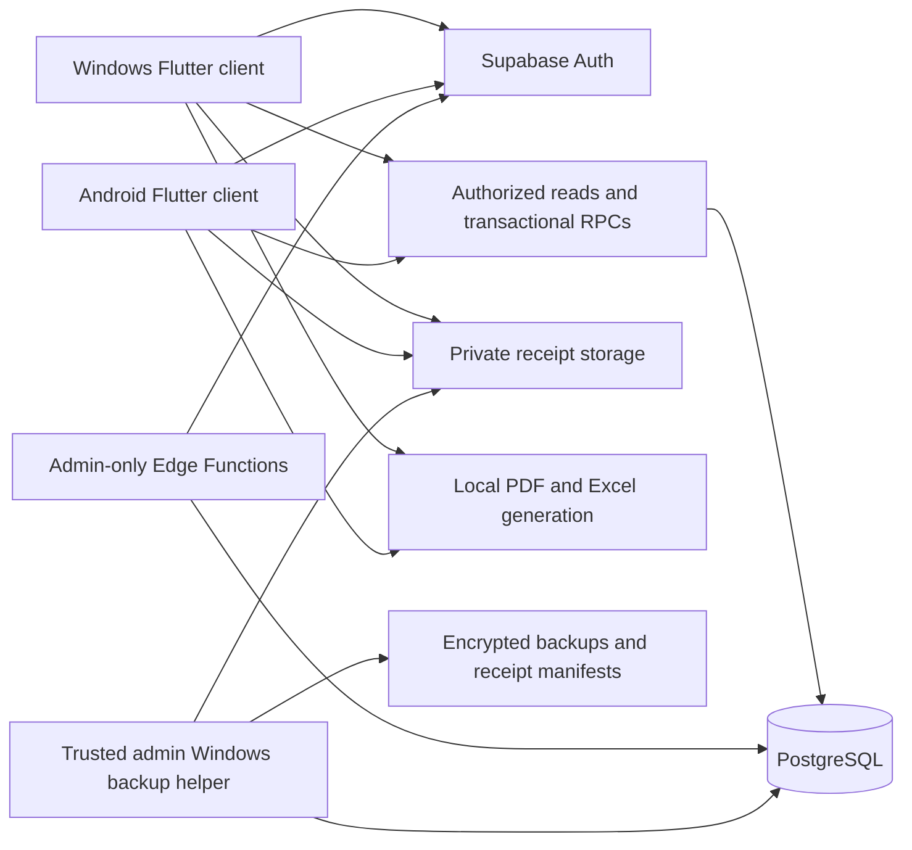

# Architecture: Carrier Records

2026-10-13 isolated update: stable typed string keys and reusable responsive bilingual widgets; English left/Urdu right or stacked, LTR page with per-run Urdu RTL. Bundle licensed Urdu font beside unchanged legacy Latin assets. Candidate runtime and launcher pin verified local endpoint/project identity, separate test config/session storage and cannot load installed production settings. Preserve external IDs/config and template1 renderer; immutable template2 snapshots carry presentation labels/branding. Prefer existing RPC contracts; any needed migration is local-only/backward-compatible. No hosted network application tests or deployment. See docs/karvaan-update.md.

Version: 1.1 | Specification date: 2026-10-11

Status: Implementation specification. No application, cloud deployment or native release is claimed by this document.

## 1. Architecture decision

Use Flutter/Dart for shared Windows and Android client code. Use Supabase Auth, PostgreSQL, private Storage, database RPCs and small privileged Edge Functions. Avoid a separate always-running API server for the free pilot.

2026-10-12 explicitly requested web deployment adds a Flutter JavaScript client served from Cloudflare Pages direct upload. It uses the same authorized backend through compiled public configuration (APP_ENV, SUPABASE_URL, SUPABASE_PUBLISHABLE_KEY, APP_BUSINESS_ID). Integer paisa uses BigInt so the full PostgreSQL money range remains exact in JavaScript. Browser secure storage is origin-specific and requires HTTPS/localhost; native protected-storage checks do not establish browser release evidence. Native Windows configuration and backup-helper I/O are guarded from web execution. No privileged helper, direct database credential or private records are distributed as static web assets. See docs/web-deployment-evidence.md for executed checks and limitations.



Public client keys identify the project; they are not authorization. Sessions, database policy and operation-specific checks enforce access. No service-role key or direct database password enters a distributed app.

## 2. Project organization

```text
project/
  PRD.md architecture.md rules.md design.md tasks.md memory.md
  app/
    lib/
      app/             # theme, routing, localization and composition
      core/            # money, dates, errors, secure session storage
      features/        # auth, masters, trips, money, outputs, recovery status
        <feature>/domain/
        <feature>/application/
        <feature>/data/
        <feature>/presentation/
    test/
    integration_test/
    windows/
    android/
  supabase/
    migrations/
    functions/         # privileged account administration
    tests/             # SQL permission and financial integration tests
  tools/
    backup/            # administrator-only setup, schedule, restore tooling
    release/           # native packaging and verification scripts
```

The initial deliverable is the six planning files. Application paths above are intended implementation paths, not existing files.

Implementation defaults: Riverpod for application state; go_router for navigation; supabase_flutter for the client adapter; secure platform storage for sessions; Dart PDF/printing and XLSX read/write adapters behind interfaces. Verify stable compatible releases before installation, commit lockfiles, and record chosen versions. Generated types and package upgrades must not bypass domain tests.

## 3. Client boundaries

Presentation widgets display typed view models and call application commands. They do not calculate authoritative balances or access tables directly. Application services coordinate online workflows. Domain objects represent Money, Quote, Trip, Allocation and OutputConfiguration. Data adapters isolate Supabase and file packages.

Client quote calculations provide immediate previews; the server recomputes and returns accepted values. Use integer paisa in Dart, explicit decimal parsing and round-half-up commission calculations. No double-based balance calculation.

The app requires internet. In-memory form state survives request errors; saving offline is never presented as successful. Network retry uses the same idempotency key. Session expiration returns users to login with a clear message; unsent financial details must not leak through logs or URL parameters.

Desktop lists use pagination, search and server-side filters. Mobile uses the same repositories with responsive cards/forms. Avoid fetching a year's raw history to render a dashboard. Client-side PDF and Excel generation runs away from interactive UI work when the payload is large.

## 4. Data model

All identifiers are UUIDs. Operational rows include business_id, created_by, created_at, updated_at and version. The pilot has one active business; business_id prevents later migration from depending on assumed global records. Multiple-business onboarding is not implemented.

| Group | Records and key relationships |
|---|---|
| Identity | businesses, offices, staff_profiles, staff_offices; Auth user → staff profile → assigned offices |
| Contacts | parties and party_roles; a real person may have multiple roles without duplicated identity |
| Fleet | vehicles → current owner party; drivers remain party records |
| Presets | routes with endpoints and suggested fare; expense_categories |
| Operations | trips with owner snapshot, vehicle, driver, offices, dates, state and optional return_of_trip_id |
| Loads | consignments → trip and customer, broker optional; stops; optional consignment_cars |
| Pricing | quote snapshots with quoted basis, mode, amount/rate, customer charge, owner entitlement and commission |
| Costs | expenses → vehicle, optional trip, office, payer, cost bearer, funding source and receipt references |
| Financial history | financial_events, journal_lines, allocations, idempotency_records and reversal/replacement links |
| Output | output_fields, output_presets, issued_documents, supersession links and immutable export snapshots |
| Integrity | audit_events, import_batches, import_rows, receipt_files and backup_status |

Used master records are archived. Trips preserve owner and price snapshots. Documents preserve company, recipient and issuer display values independently of future master-record edits.

Reportable financial lines carry vehicle/trip/consignment/expense and office-scope context as applicable. Unlinked maintenance costs belong to their expense office; trip events inherit trip access. Staff totals are calculated from permitted source lines, not global totals with drill-down hidden afterward.

## 5. Financial storage and posting

Use an immutable, balanced settlement subledger. It tracks customer claims, held trip funds, owner entitlements, commission, advances and reimbursements. It does not introduce office bank/cash accounting or a full statutory general ledger.

Account purposes:

| Purpose | Normal balance | Interpretation |
|---|---|---|
| CUSTOMER_RECEIVABLE | Debit | Recognized amount still owed by a customer |
| CUSTODY_RECEIVABLE | Debit | Trip funds a recipient must remit, return, expend or settle |
| OWNER_PAYABLE | Credit | Owner entitlement remaining after valid postings |
| BROKER_COMMISSION_PAYABLE | Credit | Commission earned and not yet settled |
| CUSTOMER_ADVANCE_CREDIT | Credit | Received trip-linked money not yet applied or refunded |
| EXPENSE_REIMBURSEMENT_PAYABLE | Credit | An advance funder's outstanding reimbursement |
| TRIP_FUNDING_PAYABLE | Credit | Non-expense trip money personally advanced by a party |
| PARTY_COST_RECOVERY | Debit | Cost owed by a non-owner bearer when someone else funded it |

Accounts are contextualized by relevant party and source records. Do not net different customers or use another trip's credit without explicit allocation. A negative owner/commission payable after reversals is a recoverable amount, not newly earned income.

Each financial event stores kind, effective_date, recorded_at, actor, payer/payee where applicable, amount, allocations, related record IDs and idempotency key. Exact amounts use NUMERIC(18,2); expose monetary values as decimal strings. Rates use exact decimals to two percentage decimal places. All postings balance to zero.

Confirmation performs authorization, version checks, amount/allocation validation, locked claim updates, journal inserts, audit writes and idempotency recording in one PostgreSQL transaction. Serialize competing consumption of the same claim/credit. An event is either fully committed or absent.

Corrections append reversal/replacement events. A reversal is allowed once and is blocked until dependent allocations are appropriately unwound. Operational metadata uses versioned updates with audit history. Current reports use effective dates; historical issued documents use their stored snapshots. recorded_at explains when a correction was made.

## 6. Interface contracts

Use SQL migrations as the source of truth and typed Dart request/response models. RPC contracts use UUID strings, ISO business dates, UTC timestamps, decimal money strings and stable enum keys.

Common mutating envelope:

```json
{
  "request_id": "uuid",
  "expected_version": 3,
  "payload": {}
}
```

Success returns record_id, new_version, canonical computed values and affected balances. Repeating the same request ID/payload returns the same committed result. Reusing an ID with a different payload returns IDEMPOTENCY_MISMATCH.

Create commands use expected_version = 0 and create version 1. Updates require the latest persisted version. Reject an update to a missing record rather than converting it into a create operation. Immutable financial corrections reference the original event instead of editing its version in place.

| Interface | Required behavior |
|---|---|
| save_trip / save_consignment | Validate office control, owner/pricing snapshots, counts and stops; drafts do not earn revenue. |
| dispatch_trip | Validate draft, reviewed prices, vehicle overlap confirmation and selected advance applications; post earnings atomically. |
| arrive_trip | Destination/admin authorization; record arrival and deliver active consignments without settling money. |
| post_financial_event | Type-specific payer/payee, allocation, custody, claim, advance and reimbursement checks. |
| correct_financial_event | Creator/admin eligibility, reason, dependency checks, single reversal and replacement. |
| cancel_and_adjust | Explicit operational cancellation plus separately specified financial adjustments/refunds. |
| get_scoped_report | Filter and aggregate only accessible records; state period basis and completeness. |
| get_output_catalogue | Return eligible fields/defaults for report and recipient under current user permissions. |
| prepare_output | Validate selected field keys/order/filters; return only authorized selected fields, required metadata and canonical totals. |
| save_output_preset | Personal scope by owner; shared preset administration restricted to admins. |
| issue_document | Allocate number and persist recipient data, values, fields/order/layout and issuer atomically. |
| get_issued_document | Return original authorized snapshot for reprint; never regenerate from current source values. |
| validate_import / commit_import | Recheck structured rows on server; commit identified rows exactly once after preview. |

Error codes include UNAUTHENTICATED, FORBIDDEN, VALIDATION_ERROR, VERSION_CONFLICT, OVERLAP_CONFIRMATION_REQUIRED, ALLOCATION_MISMATCH, INSUFFICIENT_CLAIM, INSUFFICIENT_CUSTODY, DEPENDENT_SETTLEMENTS, QUOTA_OR_STORAGE_FAILURE and IDEMPOTENCY_MISMATCH. Error messages identify an action without exposing inaccessible record data.

Do not accept client-supplied actor, business membership, issuer identity or current permissions as authoritative.

## 7. Authentication and authorization

Supabase Auth supplies sessions. Map normalized staff usernames to internal non-deliverable email identifiers for password authentication; usernames are unique within the business. Staff never need personal email accounts. Admin-only Edge Functions provision accounts, disable access and set temporary reset passwords. Disable public signup. Store privilege-bearing secrets only in function secrets and the separately trusted backup helper.

Require password change after administrator resets and revoke prior sessions. Store sessions in secure platform storage through a custom persistence adapter. Do not rely on UI hiding for enforcement.

Apply RLS to operational and financial reads and Storage objects. Revoke direct client financial writes. Transactional write functions use a narrowly privileged owner, a pinned empty search_path with qualified table names, restricted execute grants and explicit auth.uid()/business/office/operation checks. Avoid superuser-owned definer functions that implicitly bypass policy checks.

Creators may edit only within their current authorized scope. Origin control over fares persists even if another office can read the trip. A staff payment spanning inaccessible trips is rejected; an administrator must allocate it. Standalone costs use their office scope. Complete cross-office reports are administrator-only.

## 8. Output security and reproducibility

The server field catalogue contains stable key, label, group, type, recipient eligibility, required flag and default order. Client checkbox selections are requests, not permissions. Validate presets again every time they are used, including after an office assignment changes.

Build recipient-specific data transfer objects before sending data to PDF/XLSX generators. Owner output excludes customer gross fare and brokerage at the payload level. Broker output excludes owner profit. Customer output excludes other customers. No hidden worksheet, metadata or serialized source object may carry excluded values.

Preset storage contains presentation only: name, report kind, recipient kind, field order and format options. Current filters and authorized row scope are supplied for each run. Calculation queries do not depend on selected columns.

Issued snapshots contain their selected configuration and all required presentation values. Store a schema/template version and content digest. Allocate document numbers transactionally by document type and year; gaps after voids remain visible and numbers are never reused. Reprints use the original snapshot; superseding documents get new numbers and explicit references.

Numbering defaults: INV-YYYY-NNNNNN for invoices and RCP-YYYY-NNNNNN for receipts, with at least six sequence digits. YYYY follows the actual server issuance date in Asia/Karachi; payment date is a separate field. Server-derived issuer and issuance time cannot be overridden by a client request.

## 9. Excel and receipt handling

Parse template XLSX locally into typed rows and preview them. The server repeats validation, office/record checks and duplicate checks. Import master data, trip/consignment drafts and expense drafts; advance through normal confirmation flows for earnings and payments. Monetary imports use decimal strings; formulas are rejected as inputs. Do not silently coerce unknown parties/routes or ambiguous dates.

Use client batch IDs and row IDs to prevent retries from duplicating data. Committed batches cannot be edited in place. Show row-level errors; a commit transaction either accepts the reviewed batch or returns errors without partial writes.

Receipts use a private bucket with opaque paths. Accept image/PDF evidence with MIME/size validation and a pilot per-file limit of 5 MB. Compression is optional and must retain legibility. A finalized financial record must not claim receipt upload success until its object/reference exists. Clean up abandoned uploads; retain referenced objects or an explicit archived status.

## 10. Backup, restore and free-tier operations

Use a trusted Windows helper, outside the ordinary staff app, with PostgreSQL client utilities and PowerShell orchestration. Administrator setup stores database/storage credentials in Windows Credential Manager. The daily Task Scheduler job runs while that PC is online; a manual command uses the same path.

Create a database export including application schema/data, required Auth identity data and restore metadata. Exclude active sessions from recovery. Incrementally copy receipt objects by manifest/hash rather than downloading all files daily. Encrypt archives with AES-256-GCM and maintain a separately stored recovery key; a DPAPI-only key is insufficient for recovery after PC loss. Keep 30 successful daily database archives locally, subject to administrator disk settings; never delete source financial records as backup retention.

Scheduling default: daily at 18:00 in the administrator PC's local time, configurable during helper setup, with a missed-run catch-up on the next available online session. Display the configured time zone explicitly. This is an application implementation setting; no Codex reminder or live scheduled job is created by these documents.

Write success only after integrity checks. Expose last successful backup, failures, pending receipt copies and off-PC-copy reminder. The backup metadata is administrator-only. Copies in a second location must not store the recovery key alongside the archive.

Restore into a clean local/staging environment first, validate manifests, identities, roles, objects, balances and document digests, and force staff reauthentication/password resets as appropriate. Restore production only in an explicit administrator maintenance window. Record measured recovery time; a backup archive alone is not evidence of recovery.

Free-tier limits are provider-dependent. The verified planning baseline is 500 MB database, 1 GB files, inactivity pauses and no included automatic backup. Track storage/egress consumption; warn at 75% and 90% of known limits. Include backup traffic in the budget. Do not keep services awake artificially or attach an automatic paid upgrade. When a quota is reached, explain failed operations and the backup/export options.

## 11. Testing, packaging and rollout

Use Dart unit tests for money/quote/output models, SQL integration tests for journals and permissions, Flutter widget tests for forms/customization, and native integration tests for printing, connection failures and secure sessions. Exercise RLS as real staff roles rather than only a privileged SQL owner.

Index business/office/date predicates, trip state/vehicle, party claims and allocation source IDs. Use 50-row pages and server-side aggregation. Benchmark one year at 1,000 trips/month with five concurrent users; report p95 timings, device specifications and network conditions.

Generate Windows and Android runner projects with Flutter tooling during implementation. Build Windows with the official C++ workload and create a per-user installer. Build a release Android APK using a protected keystore. Use direct distribution; paid signing certificates/app-store publishing are not v1 requirements. Record hashes and release versions.

Complete the Windows office pilot and restore check before Android release. No Supabase project, privileged account, installer or APK has been created by document generation.

## 12. Primary references

- Flutter supported platforms: https://docs.flutter.dev/reference/supported-platforms
- Flutter manual installation: https://docs.flutter.dev/install/manual
- Supabase Flutter integration: https://supabase.com/docs/guides/getting-started/quickstarts/flutter
- Supabase database functions/security: https://supabase.com/docs/guides/database/functions
- Supabase row-level security: https://supabase.com/docs/guides/database/postgres/row-level-security
- Supabase pricing: https://supabase.com/pricing
- Supabase backups: https://supabase.com/docs/guides/platform/backups

Verify changing provider limits and package compatibility when implementation begins. These links support technical feasibility; they are not evidence of a deployed application.
